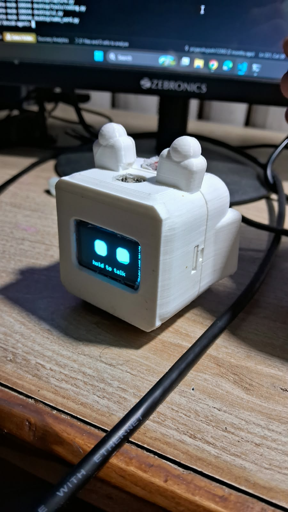

<div align="center">

# 🤖 Knoc8 Desktop Agent

**A hold-to-talk, voice-controlled AI agent that operates your Windows PC — with a cute animated face on an OLED.**

*Not a chatbot. A desktop companion that listens, plans, executes, and talks back.*


<br>
&nbsp;


<sub>The finished Knoc8 device: ESP32-C3 + INMP441 mic + OLED face + hold-to-talk button.</sub>

</div>

---

**Hold the button** on the ESP32 and speak. Let go when you are done. Knoc8 records what you say, cleans the audio, transcribes it locally, reasons about it with an LLM, plans the steps, executes them on your PC — terminal, apps, browser, files, windows, system controls — and speaks the result back through your PC speakers. All the while a little robot face blinks and reacts on the OLED, showing a live ticker of exactly what it's doing.

> 🗣️ *(hold) "Open Chrome with my Priyanshu profile and play the song CO2 on YouTube, let it play 15 seconds, then open terminal and check the npm version."*
> → Knoc8 does all five steps in order and reports back. 🔊 *"All done, sir. What would you like me to do next?"*

---

## 📸 Final Product

<div align="center">

| Device | Face |
|:---:|:---:|
|  |  |
| 3D-printed enclosure with button, mic and OLED | Animated robot face reacting to what Knoc8 is doing |

</div>

---

## ✨ Features

| | |
|---|---|
| 🎙️ **Hold-to-talk** | Hold the button, speak, let go. No silence detection, no threshold to tune. |
| 🔒 **Private by design** | No always-on listening — audio crosses the wire only while the button is physically held. |
| ✋ **Barge-in / interrupt** | Press *while it's talking* to cut it off and give a new command. |
| 🧠 **LLM reasoning + planning** | Turns speech into ordered, validated tool plans. |
| 💻 **Builds real software** | “Build me a React todo app” hands the job to Claude Code in its own window — it writes, installs, builds and fixes its own errors. |
| 🔀 **Multi-provider LLM** | Ollama Cloud, **Anthropic Claude**, or **OpenAI** — switch with one setting. |
| 🔗 **Multi-step tasks** | Chains up to 20 actions in one command, with timed `wait` steps. |
| 🖥️ **13 tool modules** | Coding agent, terminal, apps, browser, keyboard, mouse, clipboard, files, windows, system, notifications, wait, settings. |
| 🌐 **Chrome profile picker** | Reads your real Chrome profiles and asks by voice which one to open. |
| 😊 **Animated OLED face** | Robot eyes that blink, glance, squint, and smile per state + live step ticker. |
| 🔊 **Spoken replies** | Offline Windows TTS through your PC speakers, non-blocking. |
| 🎧 **Noise cancellation** | High-pass filter + spectral denoise for cleaner recognition. |
| 💾 **Persistent memory** | Remembers facts *and* auto-journals every task — survives restarts. |
| 🔌 **Auto-start on plug-in** | A watcher launches the agent automatically when the ESP32 is connected. |
| ⏸️ **Pause mode for flashing** | One toggle releases the COM port so you can re-flash the ESP32. |
| 🛠️ **Settings CLI + web panel** | `python settings.py` or the browser panel to tune everything, no code editing. |
| 🛡️ **Safety gate** | Delete, shutdown, restart & risky shell commands need confirmation. |
| 🖥️ **Live console** | A Claude-Code-style terminal shows setup, what you said, and every step as it runs. |
| ⌨️ **Text mode fallback** | No ESP32? A console REPL runs the same brain. |

---

## 🔁 How It Works

```
🔘  You hold the button ──► ESP32-C3 streams mic audio ──► USB Serial (921600) ──► PC
                                                                              │
                                              High-pass filter (kills rumble/hum)
                                                                              │
                                              You release - recording stops
                                                                              │
                                              Spectral denoise ─► Whisper (local STT)
                                                                              │
                                              LLM (MiniMax M3) plans JSON tool calls
                                                                              │
                                              Planner validates + executes each step
                                                                              │
😊  OLED face reacts + live step ticker ◄── STATUS/STEP      🔊 TTS reply ◄── LLM summary
```

**Separation of concerns:** the ESP32 is pure hardware — it only streams the mic and animates the face. *All* intelligence runs on the PC. The LLM is swappable behind one interface — `LLMProvider` has `OllamaCloudProvider`, `AnthropicProvider` (Claude, via the official `anthropic` SDK), and `OpenAIProvider` implementations; set `KNOC8_LLM_PROVIDER` to choose. Whichever you pick, the LLM never executes anything directly; it returns a JSON plan that Python validates against a tool registry before running:

```json
{
  "reply": "Opening Chrome and playing that now, sir.",
  "plan": [
    { "tool": "browser", "action": "open_chrome", "args": { "profile": "Priyanshu" } },
    { "tool": "browser", "action": "play_youtube", "args": { "query": "CO2 song" } }
  ]
}
```

---

## 📁 Project Structure

```
knoc8-desktop_agent/
├── esp32/
│   └── firmware.ino          # Button + I2S mic streaming + animated OLED face (U8g2)
└── desktop/
    ├── photo/                # Product images used in this README
    ├── main.py               # Orchestrator: hold → capture → plan → execute → speak
    ├── watcher.py            # Auto-launches the agent when the ESP32 is plugged in
    ├── settings.py           # Interactive + CLI settings editor (writes .env)
    ├── settings_web.py       # Browser settings panel
    ├── bootstrap.py          # First-run dependency + API key setup
    ├── config.py             # All settings, loaded from .env
    ├── serial_manager.py     # Serial protocol: framed audio + STATUS/STEP lines
    ├── capture.py            # Hold-to-talk capture + mic level reporting
    ├── ui.py                 # Live console: setup, transcript, per-step results
    ├── audio_dsp.py          # High-pass filter + spectral noise reduction
    ├── speech_to_text.py     # faster-whisper transcription
    ├── text_to_speech.py     # Offline pyttsx3 TTS (isolated subprocess)
    ├── llm.py                # LLMProvider → Ollama / Claude / OpenAI
    ├── planner.py            # Prompt, JSON parsing, validation, safety, summaries
    ├── confirm.py            # Native Yes/No confirmation popup
    ├── memory.py             # Facts + activity journal + conversation history
    ├── logger.py             # Console + rotating file logs (secrets redacted)
    └── tools/                # One module per capability
        ├── terminal.py       ├── applications.py   ├── browser.py
        ├── filesystem.py     ├── keyboard.py       ├── mouse.py
        ├── clipboard.py      ├── windows.py        ├── system.py
        ├── notification.py   ├── wait.py
        └── coding.py         # delegates real programming to a coding agent
```

---

## 🛠️ Tool Catalogue

The LLM picks from these; Python executes them.

| Tool | Actions |
|---|---|
| **coding** | `build` (new project) ⚠️, `continue_task` (change existing) ⚠️, `open_project`, `list_agents` — hands real programming to Claude Code / Cursor / aider |
| **terminal** | `run` (any shell command, captures output), `run_background` (dev servers), `current_dir` |
| **application** | `open`, `close`, `focus` — with aliases for Chrome, Cursor, VS Code, Terminal, Spotify... |
| **browser** | `open_chrome` (by profile), `list_chrome_profiles`, `open_url`, `search_google`, `search_youtube`, `play_youtube` |
| **filesystem** | `create_file`, `create_folder`, `rename`, `move`, `copy`, `delete` ⚠️, `list`, `read` |
| **keyboard** | `type`, `press`, `hotkey` |
| **mouse** | `move`, `click`, `right_click`, `double_click`, `scroll` |
| **clipboard** | `copy_text`, `copy_selection`, `paste`, `read` |
| **windows** | `list`, `switch`, `maximize`, `minimize` |
| **system** | `set_volume`, `get_volume`, `mute`, `set_brightness`, `lock`, `shutdown` ⚠️, `restart` ⚠️ |
| **notification** | `show` |
| **wait** | `wait` (pause between steps, up to 300s) |
| **memory** | `remember`, `recall` |

⚠️ = requires confirmation (popup Yes/No) before running.

Adding a tool = one new module in `tools/` + one line in `tools/__init__.py`.

---

## 😊 OLED Face States

The animated robot face on the SSD1306 reacts to what Knoc8 is doing:

| State | Face |
|---|---|
| **IDLE** | Round eyes that randomly **blink** and glance around · "hold to talk" |
| **LISTENING** | Big **wide** attentive eyes |
| **THINKING** | Squinted eyes darting side-to-side with animated `...` dots |
| **WORKING** | Focused eyes + sliding progress bar + **live text of the current step** |
| **SPEAKING** | Happy bouncing **smile** eyes |

While working, the PC streams each action to the display, so *"make a backend structure"* shows `run: mkdir backend` → `run: npm init -y` → `create_folder: routes` live on screen.

---

## 🔌 Hardware

| Part | Purpose |
|---|---|
| ESP32-C3 dev board | Voice interface (native USB serial) |
| INMP441 | I2S microphone |
| SSD1306 128×64 OLED (I2C, address `0x3C`) | Animated face + status |
| Momentary push button | Hold-to-talk trigger |

### Wiring (ESP32-C3)

| Component | Pin | ESP32-C3 GPIO |
|---|---|---|
| INMP441 | VCC / GND | 3.3V / GND |
| INMP441 | SCK / WS / SD | 4 / 5 / 2 |
| INMP441 | L/R | GND |
| SSD1306 | VCC / GND | 3.3V / GND |
| SSD1306 | SDA / SCL | 8 / 9 |
| Push button | leg A / leg B | 3 / GND |

> ⚠️ Keep wires away from the C3's internal flash pins (GPIO 11–17) — connecting them corrupts flash access.

Mic audio: **16 kHz · 16-bit · mono PCM** streamed over serial at **921600 baud**. Replies play through the **PC speakers** (there is no speaker on the device).

---

## 🚀 Quick Start

### 1 — Flash the ESP32-C3

1. Open `esp32/firmware.ino` in Arduino IDE (needs the **Arduino-ESP32 core 3.x**).
2. Install **U8g2** from Library Manager.
3. Tools settings: board **ESP32C3 Dev Module**, **USB CDC On Boot: Enabled**, upload speed **115200** (safest).
4. Select the board's COM port and upload.

> 💡 **Garbled OLED?** Some modules are SH1106 instead of SSD1306. If you see noise, swap the constructor to `U8G2_SH1106_128X64_NONAME_F_HW_I2C`. Upside-down? Switch `U8G2_R0` ↔ `U8G2_R2`.

> 💡 **"Write timeout" on upload?** The agent is probably holding the COM port. Turn on **Pause Knoc8** (see [Flashing](#️-flashing-while-the-agent-is-installed)), or hold **BOOT**, tap **RESET**, then upload.

### 2 — Set up the desktop app

```bash
git clone https://github.com/priyanshujoshi12363/knoc8-desktop_agent.git
cd knoc8-desktop_agent/desktop

python -m venv venv
venv\Scripts\activate

pip install -r requirements.txt
```

### 3 — Configure

Run the settings tool and set at least your Ollama Cloud API key and COM port:

```bash
python settings.py
```

Or open the browser panel with `python settings_web.py`, or create `desktop/.env` by hand (it's git-ignored):

```env
OLLAMA_API_KEY=your-ollama-cloud-api-key
KNOC8_SERIAL_PORT=COM5
```

### 4 — Run

```bash
python main.py
```

- **ESP32 connected** → hardware mode: **hold the button**, speak, let go.
- **No ESP32** → text mode: type commands into the console, same brain.

### 5 — (Optional) Auto-start on plug-in

Point a shortcut at `watcher.py` in your Windows **Startup** folder (`shell:startup`):

```bat
start "" /min pythonw "FULL\PATH\TO\desktop\watcher.py"
```

After each login the watcher runs quietly and launches the agent automatically whenever the ESP32 is connected (and stops it when unplugged). Its log is at `desktop/logs/watcher.log`.

---

## ⏸️ Flashing while the agent is installed

The agent holds the COM port, which blocks uploads. To flash:

1. Set `KNOC8_PAUSED=1` (settings panel → **Developer → Pause Knoc8**, or `python settings.py set KNOC8_PAUSED 1`).
2. Within a few seconds the watcher stops the agent and frees the port.
3. Flash the ESP32.
4. Set `KNOC8_PAUSED=0` to resume. The watcher relaunches the agent when it sees the device.

If the agent doesn't auto-start after you resume, check that `KNOC8_PAUSED` is really `0` (or absent) in `.env`, then read `desktop/logs/watcher.log`.

---

## ⚙️ Configuration

Everything lives in `desktop/.env` (managed by `settings.py`). Change the LLM by editing one variable; swap providers by implementing one new `LLMProvider` subclass.

| Variable | Default | Description |
|---|---|---|
| `KNOC8_LLM_PROVIDER` | `ollama` | `ollama`, `anthropic` (Claude), or `openai` |
| `OLLAMA_API_KEY` | — | Ollama Cloud API key (if using Ollama) |
| `KNOC8_LLM_MODEL` | `minimax-m3` | Ollama model |
| `ANTHROPIC_API_KEY` | — | Anthropic API key (if using Claude) |
| `KNOC8_ANTHROPIC_MODEL` | `claude-opus-4-8` | Claude model |
| `OPENAI_API_KEY` | — | OpenAI API key (if using OpenAI) |
| `KNOC8_OPENAI_MODEL` | `gpt-4o` | OpenAI model |
| `KNOC8_SERIAL_PORT` | `COM5` | ESP32 serial port (auto-detected if wrong) |
| `KNOC8_SERIAL_BAUD` | `921600` | Serial baud rate |
| `KNOC8_WHISPER_MODEL` | `base` | Whisper size for commands (`tiny`/`base`/`small`/`medium`) |
| `KNOC8_WHISPER_DEVICE` | `auto` | `auto` (CUDA if present), `cpu`, or `cuda` |
| `KNOC8_MAX_HOLD_MS` | `30000` | Maximum recording length while held (ms) |
| `KNOC8_TTS_RATE` | `175` | Voice speed (words/min) |
| `KNOC8_CHROME_PROFILE` | *(empty)* | Default Chrome profile (empty = ask by voice) |
| `KNOC8_CODING_AGENT` | *(auto)* | `claude`, `cursor-agent`, `aider`, `codex`, `gemini` |
| `KNOC8_NOISE_REDUCTION` | `1` | Noise cancellation on/off |
| `KNOC8_SAFE_MODE` | `1` | Ask before destructive actions |
| `KNOC8_PAUSED` | `0` | `1` = stop the agent and free the COM port for flashing |

CLI shortcuts: `python settings.py list` · `python settings.py get KEY` · `python settings.py set KEY VALUE`.

---

## 🗣️ Example Commands

| Say this | Knoc8 does |
|---|---|
| *(hold)* *"Hello, how are you?"* | Chats back naturally (no action) |
| *"What did I do last?"* | Recalls from its activity journal |
| *"Open Chrome"* | Asks which profile, then opens it |
| *"Play CO2 on YouTube"* | Finds and plays the top video in Chrome |
| *"Build me a React todo app with dark mode in D projects"* | Creates the folder, launches Claude Code to build it |
| *"Make a backend folder on D and run npm init"* | Chains folder + terminal steps |
| *"Run npm install then start the dev server"* | Multi-step terminal execution |
| *"Set volume to 40 and brightness to 70"* | System controls in one command |
| *"Remember my project is Karigar"* | Stores it permanently |
| *"Delete the old backup folder"* | ⚠️ Asks you to confirm first |

---

## 🛡️ Safety

- The LLM only **proposes** tool calls — Python validates every step against the registry before execution.
- **Confirmation required** (native Yes/No popup) for: file/folder deletion, shutdown, restart, and terminal commands matching dangerous patterns (`rm`, `del`, `format`, `diskpart`, `reg add/delete`, `taskkill /f`, ...).
- Admin commands are relaunched through Windows UAC, so the OS itself prompts you.
- Every command, transcript, and result is logged to `desktop/logs/` with API keys redacted.
- `pyautogui` failsafe: slam the mouse into a screen corner to abort automation instantly.

---

## 📡 Serial Protocol

```
PC → ESP32   STATUS:<IDLE|LISTENING|THINKING|EXECUTING|SPEAKING>   (drives the face)
             STEP:<text>                                           (live step ticker)
             REC:STOP                                              (force-stop, max hold)

ESP32 → PC   READY
             BUTTON:DOWN                      (button pressed)
             BUTTON:UP                        (button released)
             0xAA 0x55 <len lo> <len hi> <PCM>   (audio frame, ONLY while held)
```

Text lines are newline-terminated ASCII. Audio is sent as **binary frames** with a sync header and length, written in a single call. The PC parser resynchronises on the header, so a damaged audio frame can never swallow a text line such as `BUTTON:UP`.

---

## 🗺️ Roadmap

- [x] Hold-to-talk button (no always-on mic)
- [x] Barge-in interruption while speaking
- [x] Multi-step task chaining
- [x] Animated OLED face + live status
- [x] Chrome profile selection by voice
- [x] Noise cancellation
- [x] Persistent memory + activity journal
- [x] Auto-start on device connect
- [x] Pause mode for flashing
- [ ] In-page browser automation (click, read, fill forms)
- [ ] Camera + computer vision · face recognition
- [ ] Local LLM support · plugin system

---

## 🧰 Tech Stack

**Firmware:** Arduino (ESP32-C3), U8g2, ESP_I2S
**Desktop:** Python 3.10+ · rich (console UI) · faster-whisper (STT) · pyttsx3 (TTS) · noisereduce + scipy (DSP) · pyserial · pyautogui / pygetwindow / pyperclip / pycaw · Ollama Cloud (MiniMax M3)

---

## 🤝 Contributing

Fork, branch, and open a PR. New tools are the easiest entry point — add one module under `desktop/tools/` and register it in `tools/__init__.py`.

## 📄 License

MIT — see [LICENSE](LICENSE).

---

<div align="center">

**Knoc8** — the foundation for future robotics, embedded AI devices, and intelligent automation.

⭐ Star this repo if you find it useful!

</div>